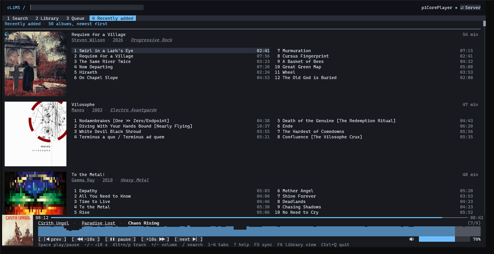
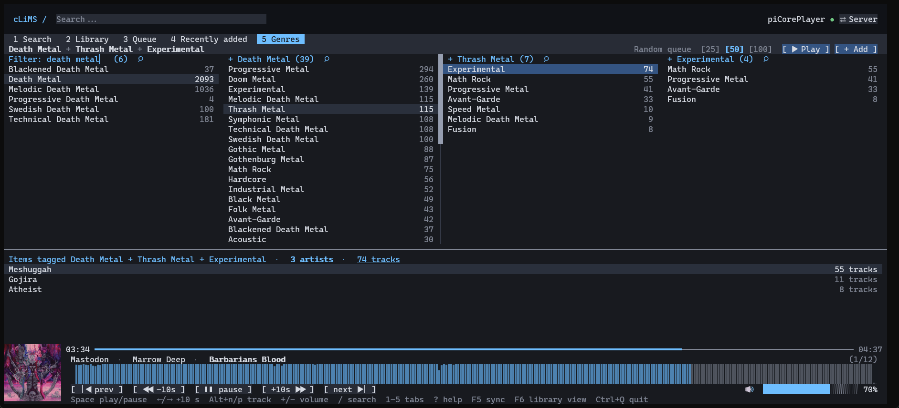
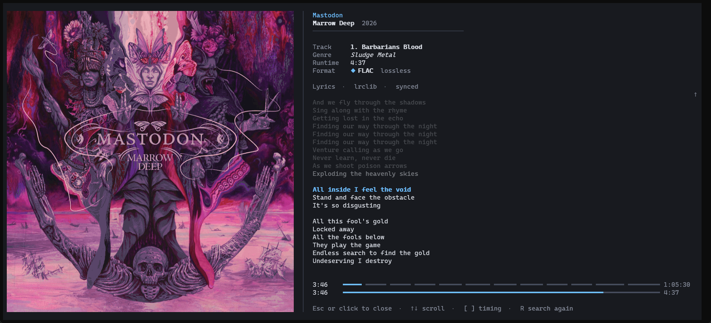
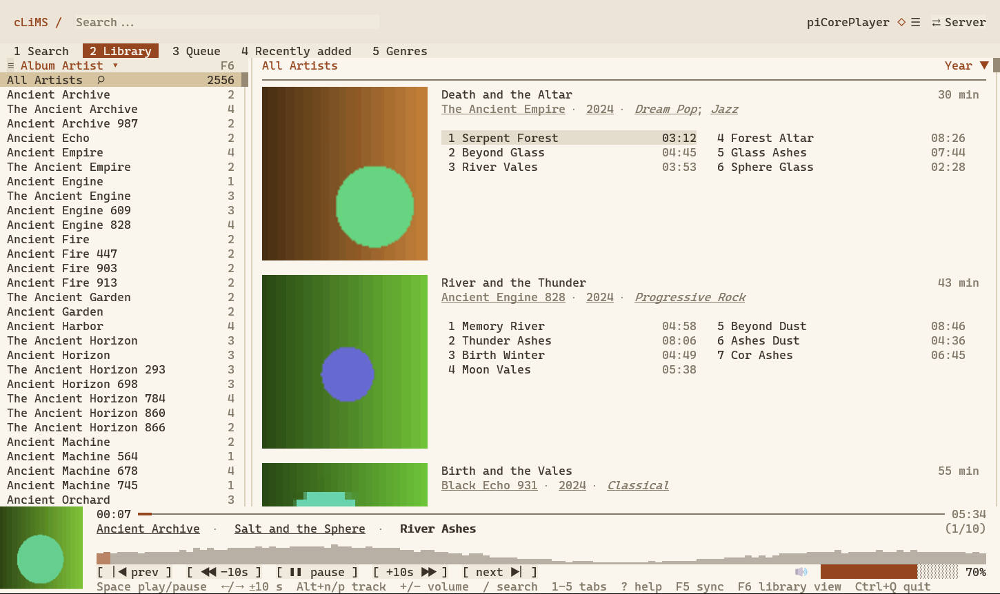
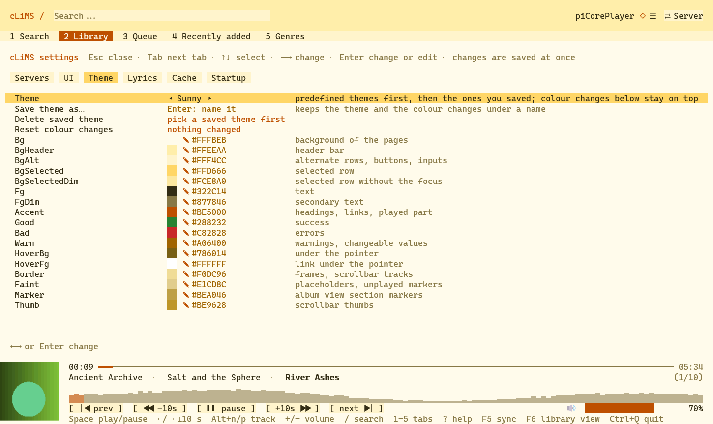
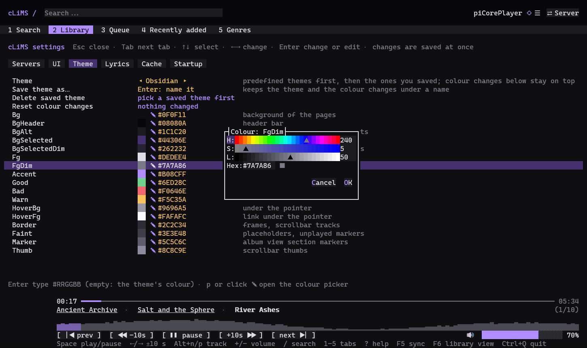

# cLiMS

[](https://github.com/tanathos/cLiMS/actions/workflows/ci.yml)

A full-screen terminal client for [Lyrion Music Server](https://lyrion.org) (LMS, formerly Logitech Media Server), built on .NET 10 and [Terminal.Gui](https://github.com/gui-cs/Terminal.Gui) v2.

Browse a large library, search it as you type, see real cover art in the terminal, and control a player (play, pause, seek, volume, queue), all from the keyboard or the mouse.

> **Status:** usable and developed against one real server (LMS 9.1.1 on a Raspberry Pi, about 20 000 tracks). Windows Terminal is the reference terminal. Planning notes and the development log are in [`docs/`](docs), starting with [`docs/sprint.md`](docs/sprint.md).

## Features
- **Library** by Album Artist, Genre or Year, with albums, genres in italic, track lists and covers. The left column is resizable, sortable and filterable.
- **Recently added:** a fourth tab with the albums the server added last, in the Library's layout (covers, track lists), newest first.
- **Online:** a sixth tab with the radios and apps the server has installed (Spotty, SpotOn, TIDAL, radio directories, anything under the server's Radio and Apps menus). Browse them level by level, search them, and play or queue what you find on your player. The server does the work, so logins and accounts are set up in the server's own plugin settings.
- **Genres explorer:** a fifth tab. Pick a genre and the next column lists the genres that share at least one track with it; pick again to narrow further (Rock, then Heavy Metal, then Thrash Metal). The artists of the tracks tagged with the whole chain are listed underneath, and a random queue of 25, 50 or 100 of those tracks can replace or join the queue. Needs a resync once: a track can carry several genres, which the sync now reads from the server genre by genre.
- **Instant search** on every keystroke over a local index (about 2 ms on 20 000 tracks). The server's own search fills in while the index is incomplete.
- **Real covers** as Sixel images (with half-block, quadrant and braille fallbacks for other terminals).
- **Playback** on your LMS player: play/pause, seek, volume, next/previous, status kept in step through server events.
- **Queue** you can reorder, trim and clear, plus **named saved queues** kept on your PC.
- **Waveform** of the current track, decoded from the real file (FLAC, MP3, Ogg, WAV). Click it to change its look: block characters, braille, or a Sixel image. The style at start-up is `UI.Waveform.Style` in `settings.json` (`Blocks`, `Braille`, `Sixel`).
- **Lyrics** in the full-screen album view: synced lines follow the music (highlighted and kept in the middle), plain ones scroll. Found once, stored for good in `lyrics.db`, so a song is never searched twice. Online lookup (LRCLIB, optionally DarkLyrics and lyrics.ovh) is off until you turn it on. See [Lyrics](#lyrics).
- **First-run connect screen:** finds servers on your network, or takes an address by hand, with optional username and password. Password-protected servers are supported everywhere. See [Connecting to a server](#connecting-to-a-server).
- **Offline friendly:** every server gets its own saved index (`catalog-<server uuid>.db`), so browsing works while the server is away, and switching servers never mixes libraries.
- Read-only toward your library: nothing is synced, and no player state changes, without you asking.

## Screenshots
The Library, with covers, genres in italic, a resizable and filterable left column whose heading stays pinned while the albums scroll, and the player footer (cover, waveform, controls). The waveform here is the Sixel style; click it to change the look (blocks, braille, Sixel). The search box shows a hint until you focus it, and the terminal title follows the player (`cLiMS ▶ - Track name`):


The Recently added tab: the newest 50 albums on the server, newest first:



The Genres explorer: Death Metal, then Thrash Metal, then Experimental, each column narrowing to the genres that share tracks with the choices so far. The artists of the tracks tagged with all three are listed underneath (click "74 tracks" to list the tracks instead), and a random queue can be started from them:



Click the cover in the player to see the playing album full screen: the cover on the left; on the right the artist, album and year, the track, genre, length and format, the lyrics, and at the bottom a progress bar for the track and, when the queue has more than one track, one for the whole queue. The queue bar is cut into one stretch per track, as long as the track, with a gap between them; with too many tracks for gaps, the stretches touch and alternate between shades of the accent colour.



Search results appear as you type, with the matched text highlighted:


The live queue (reorder, remove, clear, save under a name):


The first-run Connect screen: servers found on the network, plus a form for a specific address with optional login:


Themes (settings page, Theme tab): nine predefined themes, a swatch and hex value per colour, and a colour picker dialog (✎ or `p`) to fine tune one. Here the light Paper theme on the Library:



The Theme tab with the light Sunny theme: every colour of the theme is listed and can be changed, and your changes can be saved under a name:



The colour picker, here on the dark Obsidian theme:



The built-in key reference (`?`):


## Requirements
- [.NET 10 SDK](https://dotnet.microsoft.com/download) to build from source, or a published build: the default download needs no .NET, the `-framework-dependent` one needs the [.NET 10 runtime](https://dotnet.microsoft.com/download/dotnet/10.0).
- A true-colour terminal. [Windows Terminal](https://aka.ms/terminal) 1.22 or later is the reference and gives Sixel covers. Minimum comfortable size is 100x30; below that the footer drops the cover and waveform but keeps the controls (the `?` help scrolls when it does not fit).
- A Lyrion Music Server reachable from your PC (web port 9000, command line port 9090).

## Quick start
```
git clone https://github.com/tanathos/cLiMS.git
cd cLiMS
dotnet run --project src/Clims.Tui
```
With no saved settings the app opens the **Connect** screen. Pick your server (or type its address) and press Enter. To skip the screen, or to script it:
```
dotnet run --project src/Clims.Tui -- --lms http://192.168.1.x:9000
```
No server at hand? `dotnet run --project src/Clims.Tui -- --demo` starts with built-in fake data.

### First sync
After connecting, the app asks `Library not synced yet (N tracks, M albums). Sync now?` in the tab strip. Answer `Y` (or click). A sync takes about 1.5 minutes on a Raspberry Pi; the Library tab is usable after the first ten seconds (artists and albums), and albums on screen fetch their own tracks meanwhile. The index is saved in `%LOCALAPPDATA%\cLiMS\catalog-<server uuid>.db` (safe to delete; it is only a cache), so later launches start in a few seconds.

If the server's last scan or counts change, the header shows `Server changed, resync pending` and you are asked once; `Later` asks again at the next launch.

## Connecting to a server
The Connect screen opens when there is no address from `--lms`, `CLIMS_LMS_URL` or `settings.json`. It also opens at any time with **`F2`** or the **`⇄ Server`** button at the top right (`Esc` there keeps the current server).

1. **Discovery.** The app broadcasts a read-only request on your local network (UDP port 3483, the same one Squeezebox players use) and lists each server that answers: name, address, version. Pick one with `↑` `↓` and `Enter`, or double click. A single server is pre-selected but never connected automatically.
2. **Specific address.** A form is always shown: *Address* (`host`, `host:port` or a URL; port 9000 by default), *Username* and *Password* (both optional).
3. **Check.** `Connect` runs a read-only check and says in plain words what happened: connected, wrong username or password, nothing answered, or the address is not an LMS. Nothing is saved until it works.
4. `Esc` starts demo mode (nothing is saved, so the next launch asks again). `Ctrl+Q` quits.

Notes:
- Broadcast does not cross routers, VLANs or VPNs, and some firewalls block the reply. When nothing answers, type the address.
- Windows Firewall may ask once when the app opens its UDP socket.
- **Passwords.** The login is sent with every request: JSON-RPC, covers, waveform downloads and both event streams. It is stored only as a Windows DPAPI-protected value in `settings.json` (never in plain text, never in the log); on other systems it is not stored. A login the server rejects shows `✕ Login required (F2)` and is not retried.
- For scripts: `--user <name>` (or `CLIMS_LMS_USER`) and `--password-file <file>` (first line; or `CLIMS_LMS_PASSWORD`). There is deliberately no `--password` flag, since it would stay in shell history and the process list.

## Options and files
| Option | Meaning |
|---|---|
| `--lms <url>` | Server to use (also `CLIMS_LMS_URL`, or the address remembered from the last run) |
| `--user <name>`, `--password-file <file>` | Login for a password-protected server |
| `--player <id>` | Player to control, usually its MAC address (default: the first connected hardware player; also `PlayerId` of the server in `settings.json`) |
| `--demo` | Built-in fake library and player, no server |
| `--driver windows\|dotnet\|ansi` | Force a Terminal.Gui driver |

Files, all in `%LOCALAPPDATA%\cLiMS` (or the folder named by the `CLIMS_DATA` environment variable): `settings.json` (`settings.v1.json` is the backup of an old-style file, see Settings), `catalog-<server uuid>.db` (one index per server), `covers-<server uuid>.db` (cover cache), `lyrics.db` (lyrics, one file for all servers), `queues.json` (saved queues), `clims.log` (crashes and server problems, cut to its newest half past 1 MB; nothing is ever printed to the console while the UI runs). `CLIMS_PERF=<file>` writes per-view paint timings on exit.

## Settings

Press **`F10`** (or **`Alt+S`**, or click the **☰** at the top right) for the settings page. It has a tab for each group: **Servers** (the servers you have connected to: `Enter` connects to one now, `u` makes it the one that opens at start, `e` renames it, `d` removes it after asking, `+ Add a server…` opens the connect screen; the server in use cannot be removed), **UI** (cover style for the library lists, the footer and the full-screen cover; the library cover size; the style used where Sixel is not possible; the waveform style and whether it is shown), **Lyrics** (of the server that opens at start), **Cache** and **Startup** (the first tab, and whether to connect at once). `Tab` goes to the next tab, `↑` `↓` select, `←` `→` or `Enter` change, `Esc` closes. Every change is saved as soon as it is made; styles and sizes apply at once, and the rows marked **↻** take effect at the next start.

The page edits `settings.json` (in the data folder, indented, safe to edit by hand while cLiMS is not running). Every value is optional; this is the layout with the defaults:

```json
{
  "Version": 2,
  "Servers": [
    {
      "Name": "Home NAS",
      "Url": "http://192.168.1.20:9000/",
      "Uuid": "7c1f32ca-…",
      "Username": null,
      "ProtectedPassword": null,
      "PlayerId": null,
      "Lyrics": { "Enabled": true, "OnlineLookup": false, "Providers": [ "lrclib" ], "MissRetryDays": 1, "Files": { "PathMap": {}, "ShareUser": null, "SharePassword": null } }
    }
  ],
  "Startup": { "Server": "7c1f32ca-…", "View": "Library", "AutoConnect": true },
  "Cache": { "Covers": { "Enabled": true, "Normal": { "TtlDays": 30, "MaxEntries": 0 }, "Big": { "TtlDays": 30, "MaxEntries": 50 } } },
  "UI": {
    "Covers": {
      "Footer": { "Style": "Sixel" },
      "Library": { "Style": "Sixel", "Size": "Medium" },
      "FullScreen": { "Style": "Sixel" },
      "SixelFallback": "Quadrant"
    },
    "Waveform": { "Enabled": true, "Style": "Blocks" },
    "ShowVersion": true,
    "Theme": { "Name": "Default", "Colors": {}, "Saved": {} }
  }
}
```

- `Servers` is the list behind the switcher; `Startup.Server` is the UUID (or address) of the one that opens at start, `Startup.View` the first tab (`Library`, `Recent`, `Queue`, `Genres`, `Search`) and `AutoConnect: false` shows the connect screen at every start (an address given with `--lms` or `CLIMS_LMS_URL` still connects at once). The lyrics settings belong to each server.
- **Theme.** `UI.Theme.Name` is `Default`, `Obsidian`, `Midnight`, `Nord`, `High contrast`, `Light`, `Paper` or `Sunny`; `UI.Theme.Colors` overrides single colours of it, by slot name, as `#RRGGBB`, e.g. `"Colors": { "Accent": "#FF8800", "Bg": "#000000" }`. The slots are `Bg`, `BgHeader`, `BgAlt`, `BgSelected`, `BgSelectedDim`, `Fg`, `FgDim`, `Accent`, `Good`, `Bad`, `Warn`, `HoverBg`, `HoverFg`, `Border`, `Faint`, `Marker` and `Thumb`. Unknown names and bad colours are ignored. The Theme tab of the settings page picks the theme and edits every colour (Enter on a colour, empty text restores the theme's; `p` or a click on the ✎ icon opens a colour picker dialog to fine tune it); changes show at once. *Save theme as…* keeps the theme and your colour changes under a name (`UI.Theme.Saved`: the name → `{ "Base": "Nord", "Colors": { "Accent": "#FF8800" } }`); saved themes are listed after the predefined ones in the picker, so you can try other themes and come back, and *Delete saved theme* removes the one in use.
- Cover `Style` is `Sixel`, `HalfBlock`, `Quadrant` or `Braille`; `Size` (library and recently added lists only) is `Small` (16x8 cells), `Medium` (24x12) or `Large` (32x16). `SixelFallback` is the style used on terminals without Sixel, or for a cover that is partly out of view. `F3` and `F4` change them for the session only. Waveform `Style` is `Blocks`, `Braille` or `Sixel`; `Enabled: false` hides the waveform and downloads no waveform files. `UI.ShowVersion: false` hides the faint version number under the volume bar (also a switch on the UI page of the settings).
- **Older files.** A `settings.json` from before version 0.9.2 (flat keys such as `LmsUrl`, `Waveform` and `CoverCache`) is converted at the first launch: the old file is kept as `settings.v1.json` (`settings.v1.1.json` and so on if that name is taken) and the converted settings are saved as `settings.json`. The backup is never touched again.
- A wrong value, such as a misspelt style name, makes the whole file unreadable: it is then kept as `settings.v1.json` and the defaults are used, so check the names after editing by hand.

### Cover cache

Covers are also kept on disk, in `covers-<server uuid>.db` next to the index (a separate file, so a resync never touches it and you can delete it alone). It is filled lazily: a cover is stored the first time a view shows it, and later launches read it from disk instead of asking the server. Each resolution has its own rules in `Cache.Covers` of `settings.json` (or the Cache tab of the settings page); every value is optional and the defaults are:

```json
"Cache": {
  "Covers": {
    "Enabled": true,
    "Normal": { "TtlDays": 30, "MaxEntries": 0 },
    "Big":    { "TtlDays": 30, "MaxEntries": 50 }
  }
}
```

`Normal` is the 300 px cover in lists and the player (about 27 KB each, roughly 54 MB for 2,000 albums); `Big` is the 900 px full-screen cover (about 144 KB each, so only the newest 50 are kept). A cover older than `TtlDays` is fetched again; `TtlDays` of 0 turns that resolution off; `MaxEntries` of 0 means no limit; `Enabled: false` turns the cache off (covers still load, from the server, into memory). A broken or locked cache file is ignored, never an error.

### Lyrics

In the full-screen album view (click the cover in the player) the lyrics of the playing track appear under the album details. Lyrics are kept for good in `lyrics.db` next to the other files (one file for every server; it is not a cache, so it is never expired or trimmed), and a stored lyric is shown at once, offline too. Missing ones are searched on the internet only when you allow it: press `L` in the album view once, or turn on *Search online* in the Lyrics tab of the settings page (`OnlineLookup` in the `Lyrics` node of the server in `settings.json`). The artist, album, title and length of the track are then sent to the providers, and nothing else. The `Lyrics` node of a server (every value optional; the defaults are):

```json
"Lyrics": {
  "Enabled": true,
  "OnlineLookup": false,
  "Providers": [ "lrclib" ],
  "MissRetryDays": 1,
  "Files": { "PathMap": {}, "ShareUser": null, "SharePassword": null }
}
```

`Providers` are asked in order and the first that has the song wins: `lrclib` ([LRCLIB](https://lrclib.net), free, no key, usually with timestamps, the most accurate), `darklyrics` ([DarkLyrics](http://www.darklyrics.com), a metal archive, plain text; one request fills the store for the whole album, and requests are spaced one second apart), `lyricsovh` ([lyrics.ovh](https://lyrics.ovh), plain text). A search that finds nothing is remembered for `MissRetryDays` days (0: search every time) so a missing song is not asked for again at every play; enabling another provider searches again at once, and a provider that cannot be reached leaves nothing behind. `Enabled: false` turns lyrics off.

Two local sources are tried before any provider, and they work with `OnlineLookup` off because nothing leaves your PC. **Embedded lyrics** (the lyrics in the file's own tags: ID3 USLT, Vorbis LYRICS, MP4) are asked from the server, one small question per track; text with timestamps comes out synced, and junk such as `XXX|` is ignored. **Files next to the track** (`song.lrc` with timestamps, or `song.txt`, named like the audio file; failing that, an `.lrc` in the album folder whose name contains the title) need `Files.PathMap`, which says where the server's music folder is as this PC sees it, for example `{ "/mnt/Music": "\\\\192.168.1.100\\Music" }` (backslashes doubled, as JSON needs) (the longest matching folder is used; the address of a share that cannot be reached is not remembered as "no lyrics"). A `.txt` that is not named like the track (`info.txt`, `Tracklist.txt`) is never taken for lyrics. If the share asks for a login and this PC has none for it, set `Files.ShareUser` (`user` or `NAS\\user`) and `Files.SharePassword` in the same node: at the next launch cLiMS encrypts the password (Windows only, readable only by your Windows user on this PC) into `Files.ProtectedSharePassword` and removes the plain text from the file. The folder map and the share login are edited in `settings.json`, not in the settings page. On Linux and macOS mount the share with the system and point `Files.PathMap` at the mount.

Keys in the album view: `Up` `Down` `PgUp` `PgDn` and the wheel scroll (synced lyrics follow the music again after 8 seconds), `[` `]` shift the timing of synced lyrics by half a second, `R` searches again for a better version, `L` turns online lookup on.

## Header status
`○ Not synced` · `◐ Sync in progress, live search only · artists ✓ albums ✓ tracks 42%` · `● Synced (2 h ago)` · `◔ Server changed, resync pending` · `✕ Offline (using local index)` · `✕ Login required (F2)` · `◇ Demo data (no server)`. Click it, or press `F5`, to resync or cancel a running sync.

## Keys and mouse
Press `?` in the app for the same list.

| Key | Action |
|---|---|
| `/` | Focus the search box (typing switches to the Search tab and searches at once; `Esc` clears and returns to the previous tab, `Enter`/`Down` jumps to results) |
| `1` `2` `3` `4` `5` `6` | Search / Library / Queue / Recently added / Genres / Online tab (click the tab strip too; `4` on the tab again asks the server for the newest albums) |
| `Tab` | Move focus between panes |
| letters | Type-ahead in the left list (artist, genre or year) |
| `F6` | Switch the left list: Album Artist / Genre / Year (or click the ≡ icon in its header); click the ▾/▴ arrow to sort ascending/descending; drag the divider to resize the column (22 characters to half the screen); the ⌕ next to "All ..." (or `Ctrl+F`) turns that row into a filter field, `x` or `Esc` closes it |
| `Enter` or double click | Play the selected track, album or search result: replaces the queue and restarts the stream (not gapless). A single click only selects |
| Right click | On an album cover (whole album) or a track: menu with Play and Enqueue (arrows, `Enter` and `Esc` work in it too) |
| `a` / `n` | Add the highlighted track to the end of the queue / play it next (gapless); `A` / `N` do the same for the whole album |
| Recently added tab | The Library's album list (same keys: `Enter` plays, `a` / `n` and `A` / `N` queue) with only the newest 50 albums, newest first |
| Genres tab | `Up` `Down` pick a genre, `Enter` or `Right` go to the next column of genres that share a track with it, `Left` or `Backspace` back, `Ctrl+F` filter the active column, `Esc` clear; `Alt+R` random queue that replaces the queue (asks first), `Alt+Q` random queue appended, `[` `]` queue size 25 / 50 / 100 |
| Online tab | `Enter` open a radio, app, folder or search box, or play what is playable (replaces the queue); `o` open something that is also playable, `a` add it, `n` play it next; in a list of tracks (a playlist, Liked Songs…) `A` adds all of them to the queue, `Alt+A` replaces the queue with them and starts playing (click *shuffle* in the footer first for a random order); `Esc` or `Backspace` up one level, `r` ask the server again |
| Queue tab | `Enter` play that entry, `x` or `Delete` remove, `X` remove everything after the selected entry, `Shift+Up/Down` move, `c` clear (asks), `s` save under a name, `o` saved queues (`Enter` replace after asking, `a` append, `x` delete, `Esc` back) |
| `Space` | Play / pause |
| `Left` `Right` | Seek -10 s / +10 s |
| `Alt+n` `Alt+p` | Next / previous track (work everywhere, also while typing) |
| `+` `-` | Volume |
| `F2` | Connect screen: another server, or a login |
| `F10` or `Alt+S` | Settings page (or click the ☰ at the top right); `Esc` closes it |
| `F5` | Resync the library, or cancel a running sync |
| `F3` | Cycle the cover style of the lists (of the full-screen cover while it is open): Sixel (default, real pixels), half-block, quadrant, braille. For this session; the defaults are in `UI.Covers` of `settings.json` |
| `F4` | Cycle the list cover size: 24x12 cells (`Medium`, default), 32x16 (`Large`), 16x8 (`Small`) |
| `Y` / `L` / `N` / `Enter` / `Esc` | Answer a question shown in the tab strip (`Enter` = first answer, `Esc` = last) |
| `?` | Key reference |
| `Ctrl+Q` | Quit (`Esc` never quits; it only closes or goes back) |

The mouse wheel scrolls the pane under the pointer. Lists show a scrollbar on their right edge; click it to jump. In the footer, click the progress bar to seek (pointing ahead of the playhead previews the jump), the track length to switch to the time left, the buttons to control playback, the volume bar to set it; click the artist or album of the playing track to jump to it in the Library.

## Build, test, publish
```
dotnet build          # warnings are errors
dotnet test
```
`dotnet test` runs fast tests only (fake servers, loopback sockets). Opt-in tests that read from a real server are skipped unless you set `CLIMS_LMS_URL`:
```
$env:CLIMS_LMS_URL = "http://host:9000/"      # read-only integration tests; a full sync takes about 1.5 minutes
$env:CLIMS_CATALOG_DB = "<path to catalog-*.db>"   # times the local search on your saved index, no server needed
```
Prebuilt single-file builds are on the [Releases page](https://github.com/tanathos/cLiMS/releases), in two flavours per platform: the default one is self-contained (about 45 MB, no .NET needed), the `-framework-dependent` one is smaller (about 26 MB) but needs the .NET 10 runtime installed.

Self-contained single-file build (about 45 MB, no .NET needed on the target):
```
dotnet publish src/Clims.Tui -c Release -r win-x64 --self-contained -p:EnableCompressionInSingleFile=true -p:PublishSingleFile=true -p:IncludeNativeLibrariesForSelfExtract=true
```
Framework-dependent single-file build (about 26 MB, needs the .NET 10 runtime; compression is not available here):
```
dotnet publish src/Clims.Tui -c Release -r win-x64 --no-self-contained -p:PublishSingleFile=true -p:IncludeNativeLibrariesForSelfExtract=true
```
[`.github/workflows/ci.yml`](.github/workflows/ci.yml) builds and tests on Windows and Ubuntu and publishes the Windows build as an artifact.

## Project layout
| Path | What it is |
|---|---|
| `src/Clims.Lms` | UI-free LMS client library: JSON-RPC, typed models, events, server discovery and connection check ([README](src/Clims.Lms/README.md)) |
| `src/Clims.Catalog` | UI-free local catalogue: in-memory model, SQLite store, sync service and state machine ([README](src/Clims.Catalog/README.md)) |
| `src/Clims.Waveform` | UI-free waveform peaks of a track: download, decode, cache ([README](src/Clims.Waveform/README.md)) |
| `src/Clims.Lyrics` | UI-free lyrics: LRC parser, permanent SQLite store, LRCLIB / DarkLyrics / lyrics.ovh providers and the service that ties them together |
| `src/Clims.Tui` | The app: `Data/` (player, fake player, demo catalogue, saved queues), `Ui/` (owner-drawn views, connect screen, cover pipeline), `Session` (everything tied to one server), `SecretStore` |
| `tests/` | One test project per library, plus `Clims.Tui.Tests` for logic that needs no terminal |
| `docs/` | Research notes, design and the [sprint plan and log](docs/sprint.md) |

## Roadmap
Done so far (details in [`docs/sprint.md`](docs/sprint.md)):

| Step | Content | State |
|---|---|---|
| 1 | TUI skeleton | Done |
| 2 | LMS client library | Done |
| 3 | Local catalogue, Library tab on a real library, covers, sync status | Done |
| 4 | Ranked search over the local index | Done |
| 5 | Real playback, queue, saved queues, waveform, help, log, packaging, CI | Done. Not verified: audio-level gaplessness (needs a listening test) and the controls against a real player (checked with fakes only) |
| 6 | First run: server discovery, connect screen with address form, password-protected servers, per-server index, `F2` / `⇄ Server` | Done. Auth is tested against fakes only (no password-protected server was available) |
| 7 | Recently added tab (key `4`) from LMS `albums sort:new` | Done |
| 0.7.0 | First tagged release: MIT license, changelog, release workflow for Windows, Linux and macOS | Done |
| 0.8.0 | Full-screen album view, album context menu, sort label, queue position in the player | Done |
| 0.9.0 | Genres explorer (tab `5`) with random queues, cover cache on disk, compressed and framework-dependent builds, mouse and resize fixes | Done |

Deferred: player selector, live visualiser, key binding configuration, remembering several servers at once.

## Releases
Versions follow [Semantic Versioning](https://semver.org/) (`0.y.z` until 1.0: minor versions may change behaviour). Each release is a git tag `vX.Y.Z` with a GitHub Release holding single-file builds for `win-x64`, `linux-x64` and `osx-arm64` (zip or tar.gz, plus `SHA256SUMS`), each as a self-contained build and a smaller `-framework-dependent` one that needs the .NET 10 runtime. Changes are listed in [`CHANGELOG.md`](CHANGELOG.md). Download from the [Releases page](https://github.com/tanathos/cLiMS/releases); `Clims.Tui --version` prints the version. The builds are not code-signed, so Windows SmartScreen warns on first run, and only Windows Terminal has been tested.

To cut a release:
1. Set `<Version>` in [`Directory.Build.props`](Directory.Build.props) (the only place the version lives) and move the "Unreleased" notes in `CHANGELOG.md` under a new `## [X.Y.Z] - date` heading.
2. Commit, then `git tag -a vX.Y.Z -m "cLiMS X.Y.Z"` and `git push origin vX.Y.Z`.
3. [`.github/workflows/release.yml`](.github/workflows/release.yml) checks that the tag matches the version, builds and tests, publishes the three builds and creates the Release with the changelog section as its notes. A tag with a dash (`v0.8.0-rc.1`) becomes a pre-release.

## License
[MIT](LICENSE), copyright (c) 2026 Eros Fratini.

## Coding standards
- **One type per file.** Every top-level class, record, struct, enum and interface lives in its own file, named after the type (`CoverKey` is in `CoverKey.cs`). This applies to `src` and `tests`: test helpers and fakes get their own files too. Nested types stay inside their parent.
- Warnings are errors.

## Notes for contributors
- Terminal.Gui is pinned to 2.5.0. The API is large and moves; check `Terminal.Gui.xml` in the NuGet cache instead of memory.
- A plain `View` container needs `CanFocus = true` or its children can never take focus.
- `View` already has `Activated`, `Frame`, `Title` and `Result`; do not reuse those names for your own members (the compiler warns, and warnings are errors).
- Inside `Clims.Tui` use the alias `MusicCatalog` for `Clims.Catalog.Catalog`: the plain name resolves to the namespace.
- Never slice display strings by index: an emoji cut in half crashes Terminal.Gui. Use `PaintView.Put` / `Clip`.
- Scroll panes: reveal the selection only when it changes (not every frame) or the wheel gets undone; reserve the last column for `PaintScrollbar`.
- Covers: views ask `CoverArt.Source` and draw a placeholder until the image arrives. Sixel cannot be clipped (only fully visible covers use it) and is erased by any text written over it; views whose cover never moves (the footer) must not repaint under it, and hidden views must release theirs (`SixelCovers.Release(this)`).
- A text field must keep the global shortcuts out of the way while typing (see the queue name bar, the Library filter and the connect screen).
- LMS quirks that bit us: `titles` with the genre tag only works with an explicit `sort:albumtrack`; `artists` includes track-only people; ids can change after a rescan.
- Anything that cancels work by "no longer wanted" needs a re-check after acquiring the slot: a freed slot can start the request that was just cancelled.
- Never log credentials: not the password, the `Authorization` header or the CLI `login` line.
- SkiaSharp ships natives for Windows and macOS only: Linux needs `SkiaSharp.NativeAssets.Linux.NoDependencies` (same version, kept in step with `SkiaSharp`).
- Warnings are errors.
