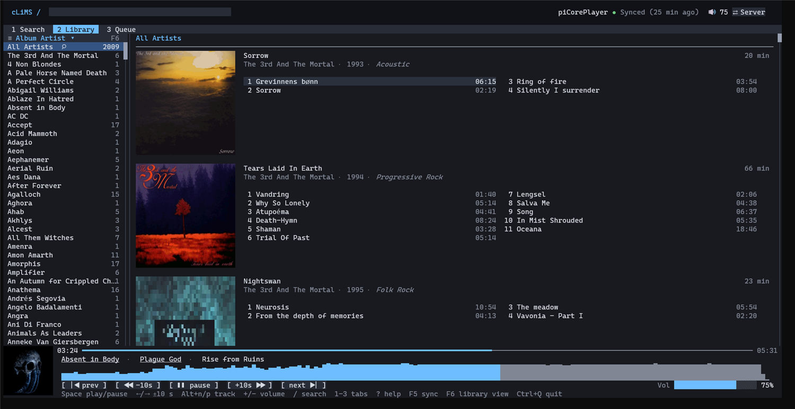
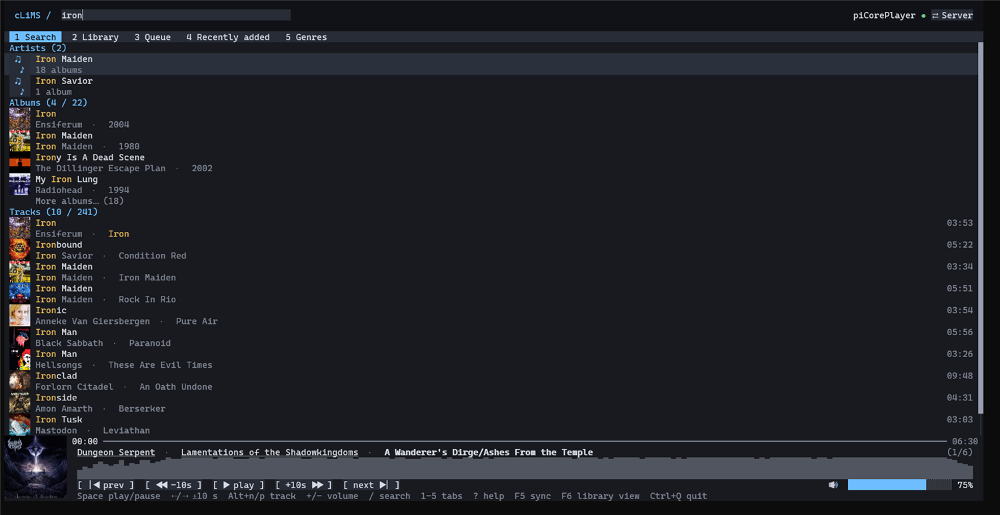
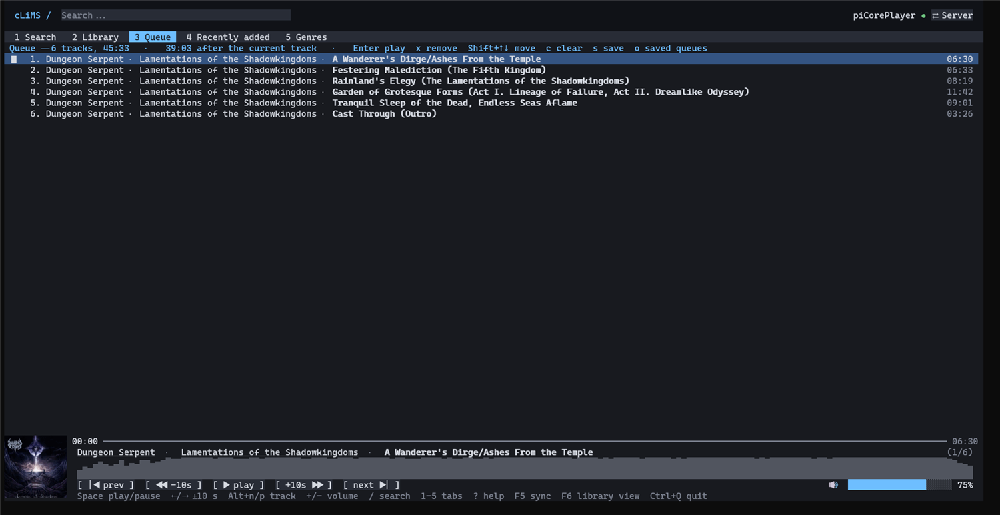
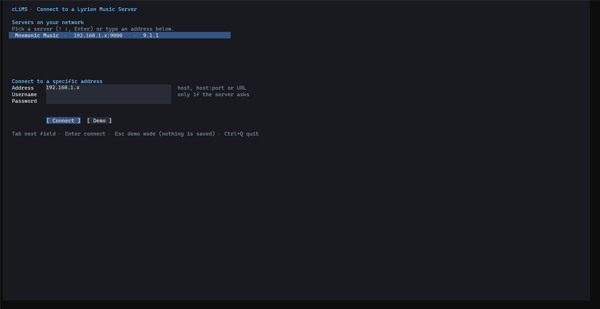
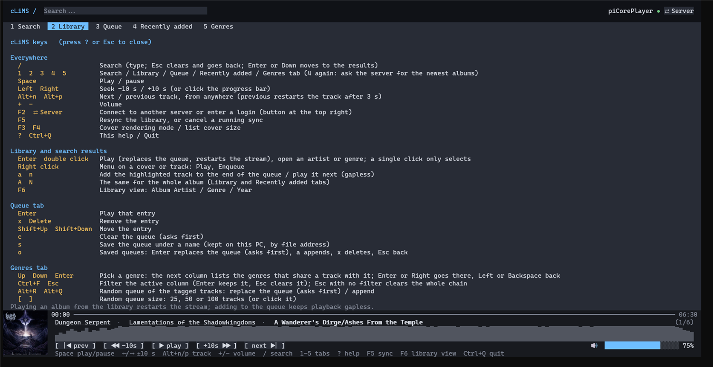

# cLiMS

[](https://github.com/tanathos/cLiMS/actions/workflows/ci.yml)

A full-screen terminal client for [Lyrion Music Server](https://lyrion.org) (LMS, formerly Logitech Media Server), built on .NET 10 and [Terminal.Gui](https://github.com/gui-cs/Terminal.Gui) v2.

Browse a large library, search it as you type, see real cover art in the terminal, and control a player (play, pause, seek, volume, queue), all from the keyboard or the mouse.

> **Status:** usable and developed against one real server (LMS 9.1.1 on a Raspberry Pi, about 20 000 tracks). Windows Terminal is the reference terminal. Planning notes and the development log are in [`docs/`](docs), starting with [`docs/sprint.md`](docs/sprint.md).

## Features
- **Library** by Album Artist, Genre or Year, with albums, genres in italic, track lists and covers. The left column is resizable, sortable and filterable.
- **Recently added:** a fourth tab with the albums the server added last, in the Library's layout (covers, track lists), newest first.
- **Instant search** on every keystroke over a local index (about 2 ms on 20 000 tracks). The server's own search fills in while the index is incomplete.
- **Real covers** as Sixel images (with half-block, quadrant and braille fallbacks for other terminals).
- **Playback** on your LMS player: play/pause, seek, volume, next/previous, status kept in step through server events.
- **Queue** you can reorder, trim and clear, plus **named saved queues** kept on your PC.
- **Waveform** of the current track, decoded from the real file (FLAC, MP3, Ogg, WAV).
- **First-run connect screen:** finds servers on your network, or takes an address by hand, with optional username and password. Password-protected servers are supported everywhere. See [Connecting to a server](#connecting-to-a-server).
- **Offline friendly:** every server gets its own saved index (`catalog-<server uuid>.db`), so browsing works while the server is away, and switching servers never mixes libraries.
- Read-only toward your library: nothing is synced, and no player state changes, without you asking.

## Screenshots
The Library, with covers, genres in italic, a resizable and filterable left column, and the player footer (cover, waveform, controls):



Search results appear as you type, with the matched text highlighted:



The live queue (reorder, remove, clear, save under a name):



The first-run Connect screen: servers found on the network, plus a form for a specific address with optional login:



The built-in key reference (`?`):



## Requirements
- [.NET 10 SDK](https://dotnet.microsoft.com/download) to build from source (or a published single-file build, which needs no .NET).
- A true-colour terminal. [Windows Terminal](https://aka.ms/terminal) 1.22 or later is the reference and gives Sixel covers. Minimum comfortable size is 100x30; below that the footer drops the cover and waveform but keeps the controls.
- A Lyrion Music Server reachable from your PC (web port 9000, command line port 9090).

## Quick start
```
git clone https://github.com/tanathos/cLiMS.git
cd cLiMS
dotnet run --project src/Clims.Tui
```
With no saved settings the app opens the **Connect** screen. Pick your server (or type its address) and press Enter. To skip the screen, or to script it:
```
dotnet run --project src/Clims.Tui -- --lms http://192.168.1.x:9000
```
No server at hand? `dotnet run --project src/Clims.Tui -- --demo` starts with built-in fake data.

### First sync
After connecting, the app asks `Library not synced yet (N tracks, M albums). Sync now?` in the tab strip. Answer `Y` (or click). A sync takes about 1.5 minutes on a Raspberry Pi; the Library tab is usable after the first ten seconds (artists and albums), and albums on screen fetch their own tracks meanwhile. The index is saved in `%LOCALAPPDATA%\cLiMS\catalog-<server uuid>.db` (safe to delete; it is only a cache), so later launches start in a few seconds.

If the server's last scan or counts change, the header shows `Server changed, resync pending` and you are asked once; `Later` asks again at the next launch.

## Connecting to a server
The Connect screen opens when there is no address from `--lms`, `CLIMS_LMS_URL` or `settings.json`. It also opens at any time with **`F2`** or the **`⇄ Server`** button at the top right (`Esc` there keeps the current server).

1. **Discovery.** The app broadcasts a read-only request on your local network (UDP port 3483, the same one Squeezebox players use) and lists each server that answers: name, address, version. Pick one with `↑` `↓` and `Enter`, or double click. A single server is pre-selected but never connected automatically.
2. **Specific address.** A form is always shown: *Address* (`host`, `host:port` or a URL; port 9000 by default), *Username* and *Password* (both optional).
3. **Check.** `Connect` runs a read-only check and says in plain words what happened: connected, wrong username or password, nothing answered, or the address is not an LMS. Nothing is saved until it works.
4. `Esc` starts demo mode (nothing is saved, so the next launch asks again). `Ctrl+Q` quits.

Notes:
- Broadcast does not cross routers, VLANs or VPNs, and some firewalls block the reply. When nothing answers, type the address.
- Windows Firewall may ask once when the app opens its UDP socket.
- **Passwords.** The login is sent with every request: JSON-RPC, covers, waveform downloads and both event streams. It is stored only as a Windows DPAPI-protected value in `settings.json` (never in plain text, never in the log); on other systems it is not stored. A login the server rejects shows `✕ Login required (F2)` and is not retried.
- For scripts: `--user <name>` (or `CLIMS_LMS_USER`) and `--password-file <file>` (first line; or `CLIMS_LMS_PASSWORD`). There is deliberately no `--password` flag, since it would stay in shell history and the process list.

## Options and files
| Option | Meaning |
|---|---|
| `--lms <url>` | Server to use (also `CLIMS_LMS_URL`, or the address remembered from the last run) |
| `--user <name>`, `--password-file <file>` | Login for a password-protected server |
| `--player <id>` | Player to control, usually its MAC address (default: the first connected hardware player; also `PlayerId` in `settings.json`) |
| `--demo` | Built-in fake library and player, no server |
| `--driver windows\|dotnet\|ansi` | Force a Terminal.Gui driver |

Files, all in `%LOCALAPPDATA%\cLiMS`: `settings.json`, `catalog-<server uuid>.db` (one index per server), `queues.json` (saved queues), `clims.log` (crashes and server problems, cut to its newest half past 1 MB; nothing is ever printed to the console while the UI runs). `CLIMS_PERF=<file>` writes per-view paint timings on exit.

## Header status
`○ Not synced` · `◐ Sync in progress, live search only · artists ✓ albums ✓ tracks 42%` · `● Synced (2 h ago)` · `◔ Server changed, resync pending` · `✕ Offline (using local index)` · `✕ Login required (F2)` · `◇ Demo data (no server)`. Click it, or press `F5`, to resync or cancel a running sync.

## Keys and mouse
Press `?` in the app for the same list.

| Key | Action |
|---|---|
| `/` | Focus the search box (typing switches to the Search tab and searches at once; `Esc` clears and returns to the previous tab, `Enter`/`Down` jumps to results) |
| `1` `2` `3` `4` | Search / Library / Queue / Recently added tab (click the tab strip too; `4` on the tab again asks the server for the newest albums) |
| `Tab` | Move focus between panes |
| letters | Type-ahead in the left list (artist, genre or year) |
| `F6` | Switch the left list: Album Artist / Genre / Year (or click the ≡ icon in its header); click the ▾/▴ arrow to sort ascending/descending; drag the divider to resize the column (22 characters to half the screen); the ⌕ next to "All ..." (or `Ctrl+F`) turns that row into a filter field, `x` or `Esc` closes it |
| `Enter` or double click | Play the selected track, album or search result: replaces the queue and restarts the stream (not gapless). A single click only selects |
| Right click | On an album cover (whole album) or a track: menu with Play and Enqueue (arrows, `Enter` and `Esc` work in it too) |
| `a` / `n` | Add the highlighted track to the end of the queue / play it next (gapless); `A` / `N` do the same for the whole album |
| Recently added tab | The Library's album list (same keys: `Enter` plays, `a` / `n` and `A` / `N` queue) with only the newest 100 albums, newest first |
| Queue tab | `Enter` play that entry, `x` or `Delete` remove, `Shift+Up/Down` move, `c` clear (asks), `s` save under a name, `o` saved queues (`Enter` replace after asking, `a` append, `x` delete, `Esc` back) |
| `Space` | Play / pause |
| `Left` `Right` | Seek -10 s / +10 s |
| `Alt+n` `Alt+p` | Next / previous track (work everywhere, also while typing) |
| `+` `-` | Volume |
| `F2` | Connect screen: another server, or a login |
| `F5` | Resync the library, or cancel a running sync |
| `F3` | Cycle cover rendering: Sixel (default, real pixels), half-block, quadrant, braille |
| `F4` | Toggle list cover size: 24x12 cells (default) / 16x8 |
| `Y` / `L` / `N` / `Enter` / `Esc` | Answer a question shown in the tab strip (`Enter` = first answer, `Esc` = last) |
| `?` | Key reference |
| `Ctrl+Q` | Quit (`Esc` never quits; it only closes or goes back) |

The mouse wheel scrolls the pane under the pointer. Lists show a scrollbar on their right edge; click it to jump. In the footer, click the progress bar to seek, the buttons to control playback, the volume bar to set it; click the artist or album of the playing track to jump to it in the Library.

## Build, test, publish
```
dotnet build          # warnings are errors
dotnet test
```
`dotnet test` runs fast tests only (fake servers, loopback sockets). Opt-in tests that read from a real server are skipped unless you set `CLIMS_LMS_URL`:
```
$env:CLIMS_LMS_URL = "http://host:9000/"      # read-only integration tests; a full sync takes about 1.5 minutes
$env:CLIMS_CATALOG_DB = "<path to catalog-*.db>"   # times the local search on your saved index, no server needed
```
Prebuilt single-file builds are on the [Releases page](https://github.com/tanathos/cLiMS/releases).

Single-file build (about 100 MB, no .NET needed on the target):
```
dotnet publish src/Clims.Tui -c Release -r win-x64 --self-contained -p:PublishSingleFile=true -p:IncludeNativeLibrariesForSelfExtract=true
```
[`.github/workflows/ci.yml`](.github/workflows/ci.yml) builds and tests on Windows and Ubuntu and publishes the Windows build as an artifact.

## Project layout
| Path | What it is |
|---|---|
| `src/Clims.Lms` | UI-free LMS client library: JSON-RPC, typed models, events, server discovery and connection check ([README](src/Clims.Lms/README.md)) |
| `src/Clims.Catalog` | UI-free local catalogue: in-memory model, SQLite store, sync service and state machine ([README](src/Clims.Catalog/README.md)) |
| `src/Clims.Waveform` | UI-free waveform peaks of a track: download, decode, cache ([README](src/Clims.Waveform/README.md)) |
| `src/Clims.Tui` | The app: `Data/` (player, fake player, demo catalogue, saved queues), `Ui/` (owner-drawn views, connect screen, cover pipeline), `Session` (everything tied to one server), `SecretStore` |
| `tests/` | One test project per library, plus `Clims.Tui.Tests` for logic that needs no terminal |
| `docs/` | Research notes, design and the [sprint plan and log](docs/sprint.md) |

## Roadmap
Done so far (details in [`docs/sprint.md`](docs/sprint.md)):

| Step | Content | State |
|---|---|---|
| 1 | TUI skeleton | Done |
| 2 | LMS client library | Done |
| 3 | Local catalogue, Library tab on a real library, covers, sync status | Done |
| 4 | Ranked search over the local index | Done |
| 5 | Real playback, queue, saved queues, waveform, help, log, packaging, CI | Done. Not verified: audio-level gaplessness (needs a listening test) and the controls against a real player (checked with fakes only) |
| 6 | First run: server discovery, connect screen with address form, password-protected servers, per-server index, `F2` / `⇄ Server` | Done. Auth is tested against fakes only (no password-protected server was available) |
| 7 | Recently added tab (key `4`) from LMS `albums sort:new` | Done |
| 0.7.0 | First tagged release: MIT license, changelog, release workflow for Windows, Linux and macOS | Done |

Deferred: player selector, live visualiser, themes and key binding configuration, remembering several servers at once.

## Releases
Versions follow [Semantic Versioning](https://semver.org/) (`0.y.z` until 1.0: minor versions may change behaviour). Each release is a git tag `vX.Y.Z` with a GitHub Release holding single-file builds for `win-x64`, `linux-x64` and `osx-arm64` (zip or tar.gz, plus `SHA256SUMS`). Changes are listed in [`CHANGELOG.md`](CHANGELOG.md). Download from the [Releases page](https://github.com/tanathos/cLiMS/releases); `Clims.Tui --version` prints the version. The builds are not code-signed, so Windows SmartScreen warns on first run, and only Windows Terminal has been tested.

To cut a release:
1. Set `<Version>` in [`Directory.Build.props`](Directory.Build.props) (the only place the version lives) and move the "Unreleased" notes in `CHANGELOG.md` under a new `## [X.Y.Z] - date` heading.
2. Commit, then `git tag -a vX.Y.Z -m "cLiMS X.Y.Z"` and `git push origin vX.Y.Z`.
3. [`.github/workflows/release.yml`](.github/workflows/release.yml) checks that the tag matches the version, builds and tests, publishes the three builds and creates the Release with the changelog section as its notes. A tag with a dash (`v0.8.0-rc.1`) becomes a pre-release.

## License
[MIT](LICENSE), copyright (c) 2026 Eros Fratini.

## Coding standards
- **One type per file.** Every top-level class, record, struct, enum and interface lives in its own file, named after the type (`CoverKey` is in `CoverKey.cs`). This applies to `src` and `tests`: test helpers and fakes get their own files too. Nested types stay inside their parent.
- Warnings are errors.

## Notes for contributors
- Terminal.Gui is pinned to 2.5.0. The API is large and moves; check `Terminal.Gui.xml` in the NuGet cache instead of memory.
- A plain `View` container needs `CanFocus = true` or its children can never take focus.
- `View` already has `Activated`, `Frame`, `Title` and `Result`; do not reuse those names for your own members (the compiler warns, and warnings are errors).
- Inside `Clims.Tui` use the alias `MusicCatalog` for `Clims.Catalog.Catalog`: the plain name resolves to the namespace.
- Never slice display strings by index: an emoji cut in half crashes Terminal.Gui. Use `PaintView.Put` / `Clip`.
- Scroll panes: reveal the selection only when it changes (not every frame) or the wheel gets undone; reserve the last column for `PaintScrollbar`.
- Covers: views ask `CoverArt.Source` and draw a placeholder until the image arrives. Sixel cannot be clipped (only fully visible covers use it) and is erased by any text written over it; views whose cover never moves (the footer) must not repaint under it, and hidden views must release theirs (`SixelCovers.Release(this)`).
- A text field must keep the global shortcuts out of the way while typing (see the queue name bar, the Library filter and the connect screen).
- LMS quirks that bit us: `titles` with the genre tag only works with an explicit `sort:albumtrack`; `artists` includes track-only people; ids can change after a rescan.
- Anything that cancels work by "no longer wanted" needs a re-check after acquiring the slot: a freed slot can start the request that was just cancelled.
- Never log credentials: not the password, the `Authorization` header or the CLI `login` line.
- SkiaSharp ships natives for Windows and macOS only: Linux needs `SkiaSharp.NativeAssets.Linux.NoDependencies` (same version, kept in step with `SkiaSharp`).
- Warnings are errors.
